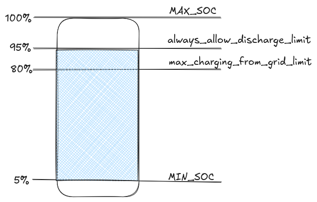

This is the main control logic configuration:

```
timezone: Europe/Berlin #your time zone. not optional.
time_resolution_minutes: 60 # Time resolution for forecasts: 15 (quarter-hourly) or 60 (hourly). Default: 60
loglevel: debug
logfile_enabled: true
log_everything: false # if false debug messages from fronius.auth and urllib3.connectionpool will be suppressed
max_logfile_size: 200 #kB
logfile_path: logs/batcontrol.log
```

## Time Resolution (with 0.6.0)
```
time_resolution_minutes: 60
```
This parameter controls the time resolution for all forecasts (solar production, consumption, and electricity prices). Valid values are:
* **60** (default) - Hourly intervals, backward compatible, lower memory usage
* **15** - Quarter-hourly intervals, higher accuracy for dynamic tariffs, 4x more data points

**Recommendation**: Use **15 minutes** if your dynamic tariff provider offers quarter-hourly prices (e.g., some Tibber or energyforecast.de plans). Use **60 minutes** for standard hourly tariffs or if you want to minimize resource usage.

**Technical Details**:
- 15-min mode: 192 intervals per 48 hours (~8 KB per forecast)
- 60-min mode: 48 intervals per 48 hours (~2 KB per forecast)
- All forecast providers automatically adapt to the configured resolution
- MQTT topics publish data at the configured interval

## Timezone
This parameter is used to calculate the correct time for your location, as some datasources deliver UTC based timeslots.
Valid values are [tz based(wikipedia)](https://en.wikipedia.org/wiki/List_of_tz_database_time_zones).

## Logfile
### Logpath
```
logfile_path: logs/batcontrol.log
```
Describes where logfiles are stored. The path can be relative or absolute.

### Log Level
```
loglevel: debug
```
Increases or decreases the verbosity of log messages. Valid entries are

* error
* warning
* info
* debug

The recommended settings are `info` and `debug`.
To reduce the noise in the default setup, we introduced
```
log_everything: false
```
Setting this to `true`, the logmessage from Fronius authentication logic + HTTP-Requests are visible in the logfile. These are very verbose messages, which is the reason to only enable it for debugging purposes.


### Enable / Disable logfile

```
logfile_enabled: true
```

This parameter is used to enable a pyhsical logfile. Console out is still active if this value is set to `false`. This can be useful in docker-based environments.

### Logsize

```
max_logfile_size: 200 #Kb
```
Amount of logsize bevore a logswitch is applied. The logs switches from log.1 to log.2 and back. Each file will be the size of `max_logfile_size`. This is used to avoid a filling up disk.

## Batcontrol alogrithm configuration

```
battery_control:
  min_price_difference: 0.05 
  min_price_difference_rel: 0.10
  always_allow_discharge_limit: 0.90
  max_charging_from_grid_limit: 0.80
  min_grid_charge_soc: 0.55 # optional: grid-charge to this SoC before expensive slots
  grid_charge_target_strategy: fixed # optional: fixed or forecast
  min_recharge_amount: 100          
```
Details about the Price configuration can be found on [price difference calculation](../features/price-difference-calculation.md) page.
`always_allow_discharge_limit` & `max_charging_from_grid_limit` is explained [here](../getting-started/how-batcontrol-works.md). `always_allow_discharge_limit: 0` is rejected at startup: it would allow discharging at every SoC, so batcontrol would never control anything. `1.0` allows discharging freely only at a full battery.



`min_grid_charge_soc` is optional. When set as a ratio, for example `0.55`, it is a minimum SoC that batcontrol secures from the grid **independent of the forecast demand**. Leave it unset to keep the default behavior.

Without it, batcontrol only recharges the energy the upcoming expensive slots are expected to need, minus what is already stored. With it, every economical grid-charging opportunity charges the battery at least up to this SoC:

- The trigger is the price signal only: a later slot with consumption that is more expensive than the current one by at least `min_price_difference`, while discharging is currently held back.
- The amount is not tied to the demand. Even when the stored energy already covers the expensive slots, batcontrol still charges up to `min_grid_charge_soc`. Example: 25 % SoC, the expensive slots need less than what is stored, `min_grid_charge_soc: 0.55` - batcontrol charges to 55 %.
- If the demand calls for more than the target, the higher amount is charged, as usual.
- Without a price signal nothing is charged: the value is not a floor that is kept at any price.

`grid_charge_target_strategy` controls how `min_grid_charge_soc` is applied:

- `fixed` (default): charge at least up to `min_grid_charge_soc`, as described above.
- `forecast`: use existing high-price-slot demand as an additional reserve. The target is roughly `min_grid_charge_soc` energy plus the calculated high-price required energy, capped by `max_charging_from_grid_limit`.

To also preserve this target as reserved energy during cheap/pre-expensive windows, enable the expert option `preserve_min_grid_charge_soc`. Without that expert option, the strategy affects grid recharge only and does not add extra discharge blocking.

If `min_grid_charge_soc` is higher than `max_charging_from_grid_limit`, grid charging cannot reach the configured minimum SoC target. Batcontrol will log a warning in this case; increase `max_charging_from_grid_limit` or lower `min_grid_charge_soc` so the settings correlate.

`min_recharge_amount` is the minimum amount of energy (Wh) that must be recharged before batcontrol activates battery charging. Once the required recharge energy reaches this minimum, batcontrol adds the same amount on top of the energy to charge, so it does not get stuck right at the threshold.

## Battery Control Expert Tuning Parameters

```
battery_control_expert:
  charge_rate_multiplier: 1.1
  soften_price_difference_on_charging: false
  soften_price_difference_on_charging_factor: 5
  spread_grid_charge_over_charge_window: true
  round_price_digits: 4
  production_offset_percent: 1.0
  preserve_min_grid_charge_soc: false
  market_price_refresh_time: "12:30"
  max_forecast_hours: 0
```

These expert parameters allow fine-tuning of Batcontrol's behavior. See [Battery Control Expert](../features/battery-control-expert.md) for detailed explanations of each parameter:

| Parameter | Type | Default | Description |
|-----------|------|---------|-------------|
| `charge_rate_multiplier` | float | 1.1 | Multiplier for calculated charge rate to compensate for charging inefficiencies |
| `soften_price_difference_on_charging` | boolean | false | Enable earlier charging based on more relaxed price difference calculations |
| `soften_price_difference_on_charging_factor` | integer | 5 | Factor to soften price difference requirements when enabled |
| `spread_grid_charge_over_charge_window` | boolean | true | With soften enabled: calculate the grid charge rate over all following slots that are not more expensive than the current slot plus the soften margin (`min_price_difference / soften_price_difference_on_charging_factor`), instead of the current slot only |
| `round_price_digits` | integer | 4 | Decimal places for price rounding in comparisons |
| `production_offset_percent` | float | 1.0 | Multiplier to adjust solar production forecast (1.0 = no change, 0.8 = 80%, etc.) |
| `preserve_min_grid_charge_soc` | boolean | false | Also preserve `min_grid_charge_soc` as reserved battery energy during cheap/pre-expensive windows |
| `market_price_refresh_time` | string | "12:30" | UTC time ("HH:MM") of the daily forced price refresh that picks up newly published next-day prices. An invalid value aborts startup |
| `max_forecast_hours` | float | 0 | Use at most this many hours of the forecasts, for example `48`. `0` does not limit the horizon |

## Configuration check at startup (with 0.11.1)

At startup batcontrol checks `battery_control` and `battery_control_expert` and reports its findings in the log, with the prefix `[Config]`. This is the first step of moving the configuration to typed models ([plan](../development/pydantic-config-migration.md)); the other sections follow later.

**Warnings** - the value is used as before, but it is very likely wrong:

| Key | Warning when | Typical cause |
|-----|--------------|---------------|
| `always_allow_discharge_limit` | outside 0..1 | `90` instead of `0.90` - Always-Allow would never trigger |
| `max_charging_from_grid_limit` | outside 0..1 | `80` instead of `0.80` |
| `min_price_difference`, `min_price_difference_rel` | below 0 | |
| `min_recharge_amount` | below 0 | |
| `battery_control_expert.round_price_digits` | below 0 | a negative value rounds every price to 0, so no grid charging happens |
| `battery_control_expert.production_offset_percent` | above 2.0 | `80` instead of `0.8`; MQTT and the API accept only 0..2 |
| inverter `max_soc` | below `always_allow_discharge_limit` (not checked for `1.0` and above) | the battery never reaches the SoC above which discharging is always allowed |
| any key the two sections do not know | always | a typo, e.g. `production_ofset_percent`, which batcontrol would otherwise ignore silently |

The ranges are the same ones that the MQTT/API setters already enforce.

**Numbers given as text** are accepted: `"0.05"` (in quotes) or `" 60 "` is used as the number. The Home Assistant add-on delivers some numbers that way. This applies to all numeric keys of both sections and needs no action; it is not reported.

**Errors** - values batcontrol cannot use, for example a text that is not a number such as `"abc"` or `"0,05"` for `min_price_difference`, or an empty value. Values that already stopped batcontrol before (for example `round_price_digits: four`) still stop it with the same message.

**Always stops startup**, independent of the mode below: `always_allow_discharge_limit: 0`. With it discharging is always allowed and the price based control never runs. `false` counts as `0` here. Batcontrol logs the reason (level `CRITICAL`, prefix `[Config]`) and exits with code 1 before it connects to the inverter, so the inverter settings stay untouched.

The environment variable `BATCONTROL_CONFIG_VALIDATION` controls how errors are handled:

- `warn` (default): errors are logged, batcontrol starts as it did before. A configuration that started with an earlier version keeps starting.
- `strict`: batcontrol stops at startup with a message that names the key. Warnings stay warnings.

`time_resolution_minutes` given as a text that is not a number (e.g. `"quarter"`) now stops startup with a message that names the key, instead of `invalid literal for int()`.
